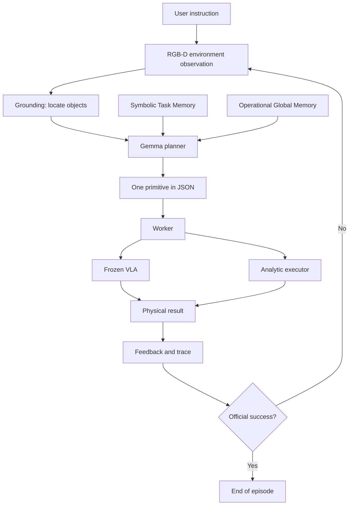

# Harness VLA: architecture guide for beginners

This document explains, from the ground up, the architecture we implemented based
on the paper **Harness VLA: Steering Frozen VLAs into Reliable Manipulation
Primitives via Memory-Guided Agents** (arXiv:2607.08448v2).

The text was written for those who have never read the paper and may have never
worked with robotics, VLA models, agent memory, or manipulation benchmarks.

The goal is to answer four questions:

1. what problem does Harness VLA try to solve;
2. what each architectural term means;
3. how the components form a complete pipeline;
4. what we actually implemented and validated.

> **Summary in one sentence:** instead of asking a single model to control the
> robot from start to finish, Harness uses a planner with memory to choose one
> small primitive at a time, execute it, observe the result, and decide the next
> step.

## 1. The basic problem

Imagine the task:

> Pick up the black bowl between the plate and the ramekin and place it on the
> plate.

For a person, the sentence seems simple. For a robot, it contains several
different problems:

- understanding which object is the correct bowl;
- figuring out where it is in the image;
- moving the arm toward it;
- positioning the gripper;
- closing the gripper at the right moment;
- confirming that the bowl was actually grasped;
- transporting the bowl without dropping it;
- locating the plate in the current scene;
- placing the bowl close enough to the center of the plate;
- confirming that the simulator considers the task completed.

An error at any point can invalidate the entire task. The simulator accepting a
movement does not mean the object was grasped. The gripper opening does not mean
the bowl was placed correctly. The object appearing correct in one frame also
does not prove that the benchmark's official predicate was satisfied.

It is this difference between **executing actions** and **solving the task** that
motivates the architecture.

## 2. What is a VLA?

VLA stands for **Vision-Language-Action**.

A VLA model receives, in simplified form:

- one or more camera images;
- an instruction in natural language;
- the current state of the robot.

As output, it produces low-level actions for the robot, such as end-effector
displacements, rotations, and gripper commands.

The **end-effector** is the final part of the robotic arm. In this project, it is
the gripper region used to reach and manipulate objects.

Our VLA backend uses the checkpoint:

```text
RLinf/RLinf-Pi05-LIBERO-130-fullshot-SFT
```

It is a pi0.5/RLinf policy trained for the LIBERO domain.

### 2.1 What does "frozen" mean?

**Frozen** means the weights of the model are not trained or changed during our
episodes.

Harness does not improve the VLA by modifying the neural network internally. It
tries to better use the capacity the VLA already possesses through:

- high-level planning;
- dividing the task into primitives;
- observation and feedback after each primitive;
- symbolic memory;
- clear termination and safety rules.

This separation is important: an improvement in the system's behavior cannot be
attributed to fine-tuning the VLA, since the checkpoint remains fixed.

## 3. What is the Harness?

In this context, **Harness** can be understood as a control and orchestration
layer around the frozen VLA.

A useful analogy is to imagine a team:

- the **planner** is the person who decides the next step;
- the **VLA** is a specialist in complex contact movements;
- the **analytic primitives** are precise tools for structured movements;
- **RGB-D perception** measures where objects are;
- the **worker** executes the chosen command;
- **memories** provide prior experience;
- the **benchmark** is the judge who decides if the task is finished.

The Harness connects these components in a closed loop. It does not assume that
the first plan will work. After each execution, it observes the result and can
replan.

This general architecture is **paper-confirmed**: its mechanism and role are
described by the paper.

## 4. Three classifications used in the project

To avoid attributing decisions that were ours to the paper, every important part
is classified in one of these ways:

### 4.1 Paper-confirmed

The mechanism and its architectural role are described in the paper.

Examples:

- frozen VLA;
- one primitive per turn;
- Task Memory and Global Memory;
- separation between bootstrap and deployment;
- use of a predicate `tau` in `vla_act`.

### 4.2 Paper-compatible

It is a necessary detail to transform the paper's contract into software, but the
paper does not specify exactly how to implement it.

Examples:

- concrete budget values;
- OSC control used in analytic primitives;
- protocol file names;
- eager execution for V100 GPU compatibility.

### 4.3 Beta-only

It is a protection, instrumentation, or limitation specific to this beta. It
should not be presented as a mechanism published by the paper.

Examples:

- SHA-256 hashes;
- local visual thresholds;
- normalized coordinates used by the Gemma locator;
- isolated privileged diagnostics;
- choosing few tasks and seeds for the functional proof.

## 5. Pipeline overview



In plain language, the cycle is:

1. observe the scene;
2. understand which objects matter;
3. consult the memories;
4. choose exactly one primitive;
5. execute that primitive;
6. measure what happened;
7. record the result;
8. terminate if the benchmark confirms success;
9. otherwise, return to the first step.

The following sections detail each component.

## 6. Planner: the high-level decision maker

The **planner** is a language model that decides which primitive should be
executed next.

Our implementation uses `gemma4:12b` with thinking enabled. The specific choice
of Gemma is **beta-only**; the role of a planner that chooses one primitive per
turn is **paper-confirmed**.

The planner receives information such as:

- task instruction;
- known objects and their roles;
- current gripper state;
- which object is being held, when known;
- feedback from the last primitive;
- remaining budget;
- Task Memory;
- Global Memory.

It does not receive privileged coordinates from the simulator. It also does not
send an entire list of actions. It must emit **a single primitive per turn**.

Example output:

```json
{
  "action": "vla_act",
  "prompt": "pick up the black bowl between the plate and the ramekin",
  "target": "akita_black_bowl_1",
  "max_chunks": 20,
  "tau": "lift_and_grasp"
}
```

Using one primitive at a time allows observing the world between decisions. If
the object moves, disappears behind the gripper, or falls, the next decision can
consider the new state.

## 7. Primitives: small units of work

A **primitive** is a command with a well-defined goal and contract. It is larger
than a single motor action, but smaller than the complete task.

Our LIBERO library has seven types:

| Primitive | Simple explanation |
|---|---|
| `vla_act` | Asks the frozen VLA to execute a complex contact phase |
| `move_to` | Moves to a visual target using analytic control |
| `move_pose` | Moves to a validated Cartesian pose |
| `rotate_wrist` | Adjusts the horizontal rotation of the wrist |
| `rotate_pitch` | Adjusts the pitch tilt of the wrist |
| `set_gripper` | Opens or closes the gripper without displacing the arm |
| `release` | Opens the gripper while maintaining the current pose |

### 7.1 Contact primitives and analytic primitives

There are two conceptual groups.

**Contact primitives** use `vla_act`. Grasping, fitting, and manipulating objects
involve physics that is difficult to model: contact, friction, orientation, and
occlusion. The VLA is used because it learned visual and motor patterns for this
type of interaction.

**Analytic primitives** use geometric rules and a controller. They are suitable
for structured movements, such as transporting the end-effector to a position,
adjusting the wrist, or opening the gripper.

The role of the two groups is **paper-confirmed**. Our OSC representation,
tolerances, and concrete budgets are **paper-compatible**.

### 7.2 What is OSC?

OSC stands for **Operational Space Control**. Instead of directly commanding each
joint of the arm, the system specifies how the end-effector should move in
Cartesian space.

For example, the controller can try to reduce the distance between the gripper's
current position and a target position. The simulator converts this intention
into joint movement.

## 8. `vla_act`, chunks, and budget

The VLA does not need to generate all the actions of the episode at once.
`vla_act` works with **chunks**, or small blocks of actions.

Our checkpoint produces native chunks of ten 7D actions. Each action contains
movement, rotation, and gripper components.

After executing actions, the system can check:

- whether the local predicate `tau` was satisfied;
- whether the benchmark declared success;
- whether the environment terminated;
- whether the primitive's budget ran out.

The **budget** is the resource limit allowed. It prevents a single primitive from
executing indefinitely.

The mechanism of chunks and stopping by `tau` is **paper-confirmed**. The
concrete size of the caps used in the benchmark is **paper-compatible**.

## 9. What is `tau`?

`tau` is a **local stopping predicate** for `vla_act`.

A predicate is a question that can be answered with true or false. Examples:

- `lift_and_grasp`: is there evidence that the object was grasped and lifted?
- `task_success`: does the environment itself already consider the task completed?

When `tau` becomes true, `vla_act` can return control to the planner earlier.
This allows replanning without consuming the entire budget.

### 9.1 Tau is not task success

This distinction is central:

- `tau_satisfied` answers whether the local stopping condition was observed;
- `primitive_success` answers whether the primitive's post-condition was verified;
- `task_success` answers whether the complete task was accepted by the benchmark.

In our final runs, the visual tau was false, but `task_success` was true. The
episode terminated correctly because the environment's official predicate is
authoritative.

The existence and role of `tau` are **paper-confirmed**. The local visual
formula, including lift thresholds, is **beta-only**.

## 10. RGB-D perception and grounding

An RGB image contains the colors of each pixel. A depth image reports the
distance from the camera to the surface seen in each pixel.

Together, they form an **RGB-D** observation:

- RGB: appearance;
- D: depth.

**Grounding** is the process of linking a symbolic description, such as "black
bowl," to an observable location in the scene.

Our pipeline does, in simplified form:

1. sends the RGB image and target description to the visual locator;
2. receives a pixel or bounding box;
3. consults the depth in that region;
4. uses camera calibration;
5. projects the image point to a 3D world position.

### 10.1 Why re-locate?

Objects can move after each action. Therefore, old geometry should not be reused
blindly. The system does **re-grounding**, that is, it locates the target again
in the current observation.

The paper describes RGB-D and world maps. Our current physical implementation
does visual grounding per frame and re-localization, but does not yet maintain a
complete persistent world map between turns.

The role of RGB-D perception is **paper-confirmed**. The concrete projection is
**paper-compatible**, and the Gemma normalized coordinate contract is
**beta-only**.

## 11. Worker: who transforms decision into execution

The planner semantically chooses what to do. The **worker** is responsible for
executing that command in the environment.

This division prevents the planner from having direct and unrestricted access to
the simulator. The worker:

- validates the command schema;
- rejects invalid fields or targets;
- resolves necessary geometry;
- calls the VLA or analytic executor;
- collects the result;
- writes state and logs;
- returns structured feedback.

In summary:

```text
planner decides the meaning
worker decides how to execute safely
```

## 12. File-mediated REPL

REPL usually means a cycle of read, execute, print, and repeat. In this
architecture, planner and worker communicate through indexed files.

For each turn there are artifacts such as:

| File | Function |
|---|---|
| `command_NN.json` | command produced by the planner |
| `log_NN.json` | command and detailed result from the worker |
| `state_NN.json` | authoritative confirmation that the turn was completed |
| `ledger.jsonl` | append-only index of events |
| `status.json` | last completed turn |

`NN` is an increasing index, such as `01`, `02`, and `03`.

### 12.1 Why use files?

The protocol makes each step auditable. It is possible to verify:

- which command was requested;
- which result was produced;
- whether a turn was completed;
- whether there was replay;
- at which point a failure occurred.

Our implementation also uses atomic writes, locking, replay protection, and
fail-closed for malformed files. These robustness details are **paper-compatible**
or **beta-only**; the role of the file-based protocol is **paper-confirmed**.

## 13. Trace and feedback

A **trace** is a structured history of execution. Each line of `trace.jsonl`
records a turn.

JSONL means each line is an independent JSON object. This allows preserving
already-completed turns even if a run is interrupted.

The trace separately records:

- planner command;
- executed primitive;
- number of actions;
- post-condition;
- local tau;
- official success;
- termination reason;
- `holding` state;
- parse or compile errors.

`holding` represents which object the system believes it is holding. It is
symbolic state, not physical proof by itself.

## 14. Task-Specific Memory

**Task-Specific Memory**, or Task Memory, stores useful structure of a specific
task learned during bootstrap.

A simplified example is:

```json
{
  "action": "vla_act",
  "target": {
    "label": "akita black bowl 1",
    "roles": ["manipulable"]
  }
}
```

It can preserve:

- symbolic order of primitives;
- object labels;
- role of each object, such as manipulable or destination;
- origin of evidence used in promotion.

It should **not** copy:

- XYZ coordinates from the bootstrap scene;
- old object pose;
- motor action compiled for another seed;
- privileged simulator geometry.

### 14.1 Why not store coordinates?

The position of a bowl in the bootstrap scene may be different in the deployment
scene. Copying old coordinates would turn memory into blind replay.

Therefore, Task Memory provides structure to the planner, while perception does
new grounding in the current scene.

### 14.2 When can a Task Memory be promoted?

Our implementation requires:

- true official success;
- complete trace;
- absence of structural error;
- verified primitive post-conditions;
- presence of a contact primitive.

If any gate fails, the memory is not promoted. These concrete guards are
**paper-compatible**. The role of Task Memory is **paper-confirmed**.

## 15. Global Memory

**Global Memory** stores operational knowledge that can be useful across multiple
tasks, not just in the specific bootstrap scene.

The main difference is:

| Task Memory | Global Memory |
|---|---|
| Structure of a specific task | Reusable operational rule |
| May cite task labels and roles | Must be independent of scene geometry |
| Helps remember what to do | Helps interpret success and failure |

Examples of global knowledge would be:

- a validated success rule;
- a failure model, such as empty grasp;
- a condition that requires new grounding.

### 15.1 Candidate is not promoted memory

The system can extract a **candidate** from a trace. An isolated boolean result
is not automatically treated as a general rule.

The candidate starts as `pending` and records:

- source file;
- trace hash;
- relevant turns;
- primitive;
- observed outcome.

An explicit semantic interpretation is necessary to promote it.

In the final run, we only promoted this limited interpretation:

> Official task success is authoritative termination even when a local visual tau
> was not satisfied.

We do not infer, from a single episode, that memory improves performance or that
a strategy will always work.

The role of Global Memory is **paper-confirmed**. Ledger, hashes, and exact audit
rules are **paper-compatible** or **beta-only**.

## 16. Bootstrap and deployment

The memory lifecycle has two separate phases.

### 16.1 Bootstrap

Bootstrap is the phase in which the system can gain experience and generate
memories.

In this phase:

- reset is allowed;
- memory writing is allowed;
- traces can generate candidates;
- a Task Memory can be promoted;
- the episode does not enter the reportable deployment metric.

### 16.2 Deployment

Deployment is the held-out phase, that is, an evaluation separate from bootstrap
experience.

In this phase:

- memory reset is prohibited;
- memory writing is prohibited;
- Task Memory and Global Memory are read-only;
- objects are located again;
- the seed belongs to the evaluation partition;
- the result can be reportable.

**Seed** is a number used to make pseudorandom choices reproducible. Separating
seeds helps prevent bootstrap and evaluation from using exactly the same sample.

**Held-out** means reserved and not used to generate the evaluated memory.

### 16.3 Why compute hashes?

A SHA-256 hash functions as a fingerprint of a file's contents. If one byte
changes, the hash tends to change.

We capture the hashes before and after deployment. Identical values prove that
memory artifacts remained unchanged during evaluation.

The hashes are a **beta-only** protection. The phase separation and frozen memory
in deployment are **paper-confirmed**.

## 17. Four signals that should not be confused

This is one of the most important parts for interpreting results.

### 17.1 Action success

Means the simulator accepted or executed an action. Does not prove that the
object was grasped or that the task finished.

### 17.2 Primitive success

Means the local post-condition of the primitive was verified. For example, a
`release` may have opened the gripper correctly.

This still does not prove that the object remained in the position required by
the benchmark.

### 17.3 Tau satisfied

Means the local stopping predicate of `vla_act` became true.

Tau serves to return control to the planner, not to replace the benchmark judge.

### 17.4 Task success

It is the environment's official predicate. It verifies the complete task and is
the authoritative source for declaring success.

The order of confidence used in the project starts with official `task_success`
and measurable physical state. LLM reasoning text is weaker evidence.

## 18. Complete pipeline, step by step

Now we can follow an episode from start to finish.

### Step 1: configure the run

The runner records checkpoint, commit, task, initial state, seed, budgets, phase,
and artifact directories.

### Step 2: load the environment

LIBERO creates the scene and positions the robot and objects according to the
initial state.

### Step 3: load the allowed memories

In bootstrap, the system can write memory after the run. In deployment, Task and
Global Memory are loaded read-only and their hashes are captured.

### Step 4: observe the scene

The runner obtains RGB, depth, and proprioceptive robot state.

**Proprioception** is the robot's internal information, such as end-effector pose
and gripper state.

### Step 5: ground the targets

The locator associates descriptions, such as "black bowl" and "plate," with
visual regions. Depth and camera transform pixels into 3D positions when needed.

### Step 6: assemble the planner context

The planner receives instruction, targets, feedback, budget, holding, and
memories.

### Step 7: choose a primitive

The planner returns a single JSON. The parser rejects invalid schema, extra
fields, and unknown targets.

### Step 8: persist the command

The protocol writes `command_NN.json` before execution.

### Step 9: execute

The worker calls `vla_act` or compiles an analytic primitive. Execution respects
budget, tau, and environment termination.

### Step 10: measure the post-condition

The system verifies the available physical result without transforming accepted
action into false success.

### Step 11: consult official success

The runner calls the environment's official predicate. If it is true, the episode
terminates immediately.

### Step 12: record state, log, and trace

The result is persisted. If there was no success, feedback returns to the planner
and the cycle begins again with an updated observation.

### Step 13: finalize the memory lifecycle

After an eligible bootstrap, the gates decide whether Task Memory can be created
and extract Global Memory candidates. After deployment, the hashes are compared.

## 19. Real validated example

We used LIBERO-Spatial task 0:

> Pick up the black bowl between the plate and the ramekin and place it on the
> plate.

### 19.1 Bootstrap

- seed: 7;
- initial state: 0;
- official result: success;
- planner turns: 1;
- physical actions: 79;
- primitive: `vla_act(max_chunks=20, tau=lift_and_grasp)`;
- privileged perception in policy: disabled;
- reportable episode: no.

The run passed the strict gates and generated symbolic Task Memory. A Global
Memory candidate was reviewed and explicitly promoted.

### 19.2 Held-out deployment

- seed: 101;
- initial state: 1, different from bootstrap;
- official result: success;
- `harness_complete=true`;
- planner turns: 1;
- physical actions: 85;
- memories: read-only;
- privileged perception in policy: disabled;
- reportable episode: yes.

All four Task and Global Memory hashes remained identical before and after. The
integrity result was `unchanged=true`.

### 19.3 What does this example prove?

It proves that the minimal lifecycle works end-to-end:

- physical bootstrap;
- strict memory promotion;
- deployment preparation;
- read-only loading;
- new held-out initial state and seed;
- official success;
- unchanged memory.

### 19.4 What does this example not prove?

The two runs finished with a single VLA call. Therefore, they do not prove
successful physical composition between VLA and analytic primitives within the
same lifecycle.

They also do not prove statistical improvement over the baseline, as we did not
execute sufficient seeds or paired memory ablations.

## 20. How the architecture fails safely

The system tries to **fail closed**. This means rejecting an ambiguous situation
instead of guessing and executing something potentially incorrect.

Examples:

- malformed JSON generates `parse_error`;
- primitive outside the contract generates `compile_error`;
- unknown target is rejected;
- incomplete trace does not promote Task Memory;
- `task_success=false` blocks promotion;
- deployment cannot write memory;
- tampered provenance is rejected;
- gaps and conflicting replay in REPL fail before advancing the turn.

Not all failures are equal. The project classifies problems into LLM format,
primitive contract, grounding, perception, planning, physical execution,
infrastructure, and instrumentation.

## 21. What was necessary to run in practice

Our environment uses Tesla V100 GPUs. The compiled OpenPI runtime tried to use
Triton resources incompatible with `sm_70`. The solution was to run the
checkpoint in eager mode, without changing its weights:

```text
TORCH_COMPILE_DISABLE=1
TORCHDYNAMO_DISABLE=1
```

Other adaptations included:

- correct configuration of LIBERO's `PYTHONPATH`;
- offscreen rendering with EGL;
- Python 3.8 compatibility;
- protection against provenance paths relative to the current directory;
- unique temporary names for concurrent atomic writing.

These are runtime and engineering decisions, not new scientific mechanisms from
the paper.

## 22. Current limitations

It is important to read the results accurately:

- we validated architecture and minimal lifecycle, not statistical reproduction;
- the complete persistent world map is not yet integrated;
- the physical runner uses the synchronous file bridge, although the persistent
  worker was validated in subprocess;
- placement showed physical variation in previous runs;
- a crash after physical action and before state commit still leaves a
  non-transactional window;
- we did not run sufficient ablations with memory on and off;
- we did not reproduce LIBERO-Pro, all LIBERO suites, RoboCasa365, or RoboTwin
  C2R;
- we do not claim statistically significant improvement over the frozen baseline.

## 23. Quick glossary

| Term | Meaning |
|---|---|
| VLA | Model that transforms vision and language into actions |
| Frozen | Model weights remain unchanged |
| Harness | Layer that plans, executes, observes, and uses memory around the VLA |
| Planner | Model that chooses the next primitive |
| Primitive | Structured execution unit |
| Worker | Component that validates and executes the primitive |
| Chunk | Small block of actions produced by the VLA |
| Budget | Limit of actions, chunks, steps, or turns |
| Tau | Local stopping predicate of `vla_act` |
| Post-condition | Condition that must be true after a primitive |
| Grounding | Association between symbolic description and observed object |
| RGB-D | Color image accompanied by depth |
| World map | Persistent spatial representation of the environment |
| Task Memory | Symbolic structure of a specific task |
| Global Memory | Reusable operational knowledge |
| Bootstrap | Phase that can generate and write memory |
| Deployment | Held-out phase that uses memory read-only |
| Held-out | Reserved, not used to produce the evaluated memory |
| Seed | Number that controls reproducible randomness |
| Trace | Structured history of turns |
| JSONL | Format with one JSON object per line |
| REPL | Cycle of read, execute, record, and repeat |
| Hash | Fingerprint used to verify integrity |
| Provenance | Verifiable origin of an artifact or rule |
| Benchmark | Standardized set of tasks and metrics |
| Task success | Official verdict of task completion |

## 24. Where to find each part

- canonical architecture and results report:
  `docs/HARNESS_VLA_FUNCTIONAL_ARCHITECTURE_REPORT.md`;
- development and evaluation process:
  `docs/HARNESS_VLA_BEST_PRACTICES.md`;
- implementation roadmap:
  `docs/HARNESS_VLA_IMPLEMENTATION_ROADMAP.md`;
- historical run reports: `docs/runs/`;
- multi-turn evaluator:
  `EmbodiedBench/embodiedbench/evaluator/libero_multi_turn_evaluator.py`;
- planner:
  `EmbodiedBench/embodiedbench/planner/harness/libero_multi_turn_planner.py`;
- memory lifecycle:
  `EmbodiedBench/embodiedbench/evaluator/libero_memory_lifecycle.py`;
- file-based protocol:
  `EmbodiedBench/embodiedbench/evaluator/libero_file_repl.py`;
- visual grounding:
  `EmbodiedBench/embodiedbench/planner/harness/libero_visual_grounding.py`.

## 25. Conclusion

Harness VLA is not just a larger model giving commands to the robot. It is an
architecture that separates responsibilities:

- the planner semantically chooses the next step;
- the frozen VLA handles complex interaction;
- analytic primitives execute structured movements;
- RGB-D connects words to observed geometry;
- the worker protects the execution contract;
- traces make the process auditable;
- Task Memory preserves specific structure;
- Global Memory preserves operational knowledge;
- bootstrap learns without contaminating deployment;
- the benchmark maintains the final word on success.

Our implementation validated this minimal lifecycle with a physical bootstrap
and a successful held-out deployment, using promoted symbolic memory that
remained unchanged. This is a functional architecture result. The next level of
evidence requires more tasks, more seeds, ablations, and paired comparisons
without changing mechanisms in the middle of evaluation.

## References

- Paper: [arXiv:2607.08448v2](https://arxiv.org/abs/2607.08448)
- Complete technical report:
  [HARNESS_VLA_FUNCTIONAL_ARCHITECTURE_REPORT.md](HARNESS_VLA_FUNCTIONAL_ARCHITECTURE_REPORT.md)
- Best practices:
  [HARNESS_VLA_BEST_PRACTICES.md](HARNESS_VLA_BEST_PRACTICES.md)
- Roadmap:
  [HARNESS_VLA_IMPLEMENTATION_ROADMAP.md](HARNESS_VLA_IMPLEMENTATION_ROADMAP.md)
