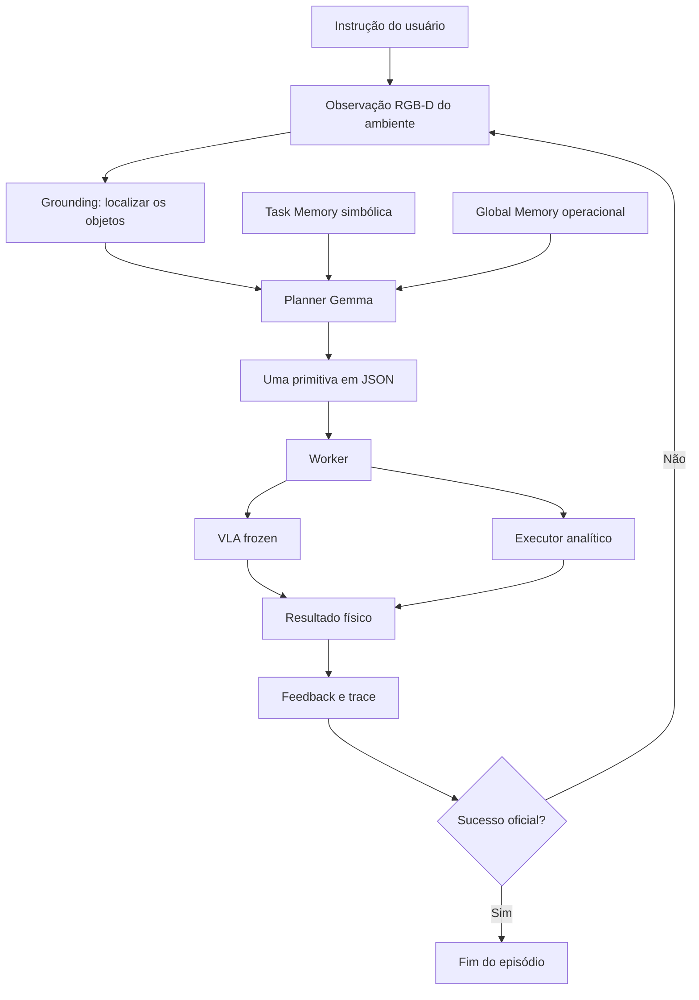

# Harness VLA: guia da arquitetura para iniciantes

Este documento explica, desde o início, a arquitetura que implementamos a partir
do paper **Harness VLA: Steering Frozen VLAs into Reliable Manipulation
Primitives via Memory-Guided Agents** (arXiv:2607.08448v2).

O texto foi escrito para quem nunca leu o paper e talvez nunca tenha trabalhado
com robótica, modelos VLA, memória de agentes ou benchmarks de manipulação.

O objetivo é responder quatro perguntas:

1. qual problema o Harness VLA tenta resolver;
2. o que significa cada termo da arquitetura;
3. como os componentes formam uma pipeline completa;
4. o que nós realmente implementamos e validamos.

> **Resumo em uma frase:** em vez de pedir que um único modelo controle o robô
> do começo ao fim, o Harness usa um planejador com memória para escolher uma
> pequena primitiva por vez, executá-la, observar o resultado e decidir o próximo
> passo.

## 1. O problema básico

Imagine a tarefa:

> Pegue a tigela preta que está entre o prato e o ramekin e coloque-a sobre o
> prato.

Para uma pessoa, a frase parece simples. Para um robô, ela contém vários
problemas diferentes:

- entender qual objeto é a tigela correta;
- descobrir onde ela está na imagem;
- mover o braço até ela;
- posicionar a garra;
- fechar a garra no momento certo;
- confirmar que a tigela foi realmente agarrada;
- transportar a tigela sem soltá-la;
- localizar o prato na cena atual;
- colocar a tigela perto o suficiente do centro do prato;
- confirmar que o simulador considera a tarefa concluída.

Um erro em qualquer ponto pode invalidar a tarefa inteira. O simulador aceitar
um movimento não significa que o objeto foi agarrado. A garra abrir não
significa que a tigela foi colocada corretamente. O objeto parecer correto em
um frame também não prova que o predicado oficial do benchmark foi satisfeito.

É essa diferença entre **executar ações** e **resolver a tarefa** que motiva a
arquitetura.

## 2. O que é um VLA?

VLA é a sigla para **Vision-Language-Action**, ou visão-linguagem-ação.

Um modelo VLA recebe, de forma simplificada:

- uma ou mais imagens da câmera;
- uma instrução em linguagem natural;
- o estado atual do robô.

Como saída, ele produz ações de baixo nível para o robô, como deslocamentos do
end-effector, rotações e comandos da garra.

O **end-effector** é a parte final do braço robótico. Neste projeto, é a região
da garra usada para alcançar e manipular objetos.

Nosso backend VLA usa o checkpoint:

```text
RLinf/RLinf-Pi05-LIBERO-130-fullshot-SFT
```

Ele é uma política pi0.5/RLinf treinada para o domínio LIBERO.

### 2.1 O que significa "frozen"?

**Frozen** significa congelado. Os pesos do modelo não são treinados nem
alterados durante nossos episódios.

O Harness não melhora o VLA modificando internamente a rede neural. Ele tenta
usar melhor a capacidade que o VLA já possui por meio de:

- planejamento de alto nível;
- divisão da tarefa em primitivas;
- observação e feedback após cada primitiva;
- memória simbólica;
- regras claras de término e segurança.

Essa separação é importante: uma melhoria no comportamento do sistema não pode
ser atribuída a fine-tuning do VLA, pois o checkpoint permanece fixo.

## 3. O que é o Harness?

Neste contexto, **Harness** pode ser entendido como uma camada de controle e
orquestração ao redor do VLA frozen.

Uma analogia útil é imaginar uma equipe:

- o **planner** é a pessoa que decide o próximo passo;
- o **VLA** é um especialista em movimentos complexos de contato;
- as **primitivas analíticas** são ferramentas precisas para movimentos
  estruturados;
- a **percepção RGB-D** mede onde os objetos estão;
- o **worker** executa o comando escolhido;
- as **memórias** fornecem experiência anterior;
- o **benchmark** é o juiz que decide se a tarefa terminou.

O Harness conecta esses componentes em um ciclo fechado. Ele não presume que o
primeiro plano dará certo. Depois de cada execução, ele observa o resultado e
pode replanejar.

Essa arquitetura geral é **paper-confirmed**: seu mecanismo e seu papel são
descritos pelo paper.

## 4. Três classificações usadas no projeto

Para não atribuir ao paper decisões que foram nossas, toda parte importante é
classificada de uma destas formas:

### 4.1 Paper-confirmed

O mecanismo e seu papel arquitetural são descritos no paper.

Exemplos:

- VLA frozen;
- uma primitiva por turno;
- Task Memory e Global Memory;
- separação entre bootstrap e deployment;
- uso de um predicado `tau` em `vla_act`.

### 4.2 Paper-compatible

É um detalhe necessário para transformar o contrato do paper em software, mas
o paper não determina exatamente como implementá-lo.

Exemplos:

- valores concretos de budget;
- controle OSC usado nas primitivas analíticas;
- nomes dos arquivos do protocolo;
- execução eager para compatibilidade com GPUs V100.

### 4.3 Beta-only

É uma proteção, instrumentação ou limitação específica desta beta. Ela não deve
ser apresentada como mecanismo publicado pelo paper.

Exemplos:

- hashes SHA-256;
- thresholds visuais locais;
- coordenadas normalizadas usadas pelo locator Gemma;
- diagnósticos privilegiados isolados;
- escolha de poucas tarefas e seeds para a prova funcional.

## 5. Visão geral da pipeline



Em linguagem simples, o ciclo é:

1. observar a cena;
2. entender quais objetos importam;
3. consultar as memórias;
4. escolher exatamente uma primitiva;
5. executar essa primitiva;
6. medir o que aconteceu;
7. registrar o resultado;
8. terminar se o benchmark confirmar sucesso;
9. caso contrário, voltar ao primeiro passo.

As próximas seções detalham cada componente.

## 6. Planner: o decisor de alto nível

O **planner** é um modelo de linguagem que decide qual primitiva deve ser
executada em seguida.

Nossa implementação usa `gemma4:12b` com thinking ativado. A escolha específica
do Gemma é **beta-only**; o papel de um planner que escolhe uma primitiva por
turno é **paper-confirmed**.

O planner recebe informações como:

- instrução da tarefa;
- objetos conhecidos e seus papéis;
- estado atual da garra;
- qual objeto está sendo segurado, quando conhecido;
- feedback da última primitiva;
- budget restante;
- Task Memory;
- Global Memory.

Ele não recebe coordenadas privilegiadas do simulador. Também não envia uma
lista inteira de ações. Ele deve emitir **uma única primitiva por turno**.

Exemplo de saída:

```json
{
  "action": "vla_act",
  "prompt": "pick up the black bowl between the plate and the ramekin",
  "target": "akita_black_bowl_1",
  "max_chunks": 20,
  "tau": "lift_and_grasp"
}
```

Usar uma primitiva por vez permite observar o mundo entre decisões. Se o objeto
mover, desaparecer atrás da garra ou cair, a próxima decisão pode considerar o
novo estado.

## 7. Primitivas: unidades pequenas de trabalho

Uma **primitiva** é um comando com objetivo e contrato bem definidos. Ela é
maior do que uma única ação de motor, mas menor do que a tarefa completa.

Nossa biblioteca LIBERO possui sete tipos:

| Primitiva | Explicação simples |
|---|---|
| `vla_act` | Pede ao VLA frozen que execute uma fase complexa de contato |
| `move_to` | Move até um alvo visual usando controle analítico |
| `move_pose` | Move até uma pose cartesiana validada |
| `rotate_wrist` | Ajusta a rotação horizontal do punho |
| `rotate_pitch` | Ajusta a inclinação do punho |
| `set_gripper` | Abre ou fecha a garra sem deslocar o braço |
| `release` | Abre a garra mantendo a pose atual |

### 7.1 Primitivas de contato e primitivas analíticas

Existem dois grupos conceituais.

**Primitivas de contato** usam `vla_act`. Agarrar, encaixar e manipular objetos
envolvem física difícil de modelar: contato, atrito, orientação e oclusão. O VLA
é usado porque aprendeu padrões visuais e motores para esse tipo de interação.

**Primitivas analíticas** usam regras geométricas e um controlador. Elas são
adequadas para movimentos estruturados, como transportar o end-effector até uma
posição, ajustar o punho ou abrir a garra.

O papel dos dois grupos é **paper-confirmed**. Nossa representação OSC,
tolerâncias e budgets concretos são **paper-compatible**.

### 7.2 O que é OSC?

OSC significa **Operational Space Control**. Em vez de comandar diretamente
cada junta do braço, o sistema especifica como o end-effector deve se mover no
espaço cartesiano.

Por exemplo, o controlador pode tentar reduzir a distância entre a posição
atual da garra e uma posição-alvo. O simulador converte essa intenção em
movimento das juntas.

## 8. `vla_act`, chunks e budget

O VLA não precisa gerar todas as ações do episódio de uma vez. `vla_act` trabalha
com **chunks**, ou pequenos blocos de ações.

Nosso checkpoint produz chunks nativos de dez ações 7D. Cada ação contém
componentes de movimento, rotação e garra.

Depois de executar ações, o sistema pode verificar:

- se o predicado local `tau` foi satisfeito;
- se o benchmark declarou sucesso;
- se o ambiente terminou;
- se o budget da primitiva acabou.

O **budget** é o limite de recursos permitido. Ele evita que uma única
primitiva execute indefinidamente.

O mecanismo de chunks e parada por `tau` é **paper-confirmed**. O tamanho
concreto dos caps usados no benchmark é **paper-compatible**.

## 9. O que é `tau`?

`tau` é um **predicado de parada local** para `vla_act`.

Um predicado é uma pergunta que pode ser respondida com verdadeiro ou falso.
Exemplos:

- `lift_and_grasp`: há evidência de que o objeto foi agarrado e levantado?
- `task_success`: o próprio ambiente já considera a tarefa concluída?

Quando `tau` fica verdadeiro, `vla_act` pode devolver o controle ao planner mais
cedo. Isso permite replanejar sem consumir todo o budget.

### 9.1 Tau não é sucesso da tarefa

Essa distinção é central:

- `tau_satisfied` responde se a condição local de parada foi observada;
- `primitive_success` responde se a pós-condição da primitiva foi verificada;
- `task_success` responde se a tarefa completa foi aceita pelo benchmark.

Em nossas runs finais, o tau visual ficou falso, mas `task_success` ficou
verdadeiro. O episódio terminou corretamente porque o predicado oficial do
ambiente é autoritativo.

A existência e o papel de `tau` são **paper-confirmed**. A fórmula visual local,
incluindo thresholds de lift, é **beta-only**.

## 10. Percepção RGB-D e grounding

Uma imagem RGB contém as cores de cada pixel. Uma imagem de profundidade
informa a distância da câmera até a superfície vista em cada pixel.

Juntas, elas formam uma observação **RGB-D**:

- RGB: aparência;
- D: profundidade.

O **grounding** é o processo de ligar uma descrição simbólica, como "tigela
preta", a uma localização observável na cena.

Nossa pipeline faz, de forma simplificada:

1. envia a imagem RGB e a descrição do alvo ao locator visual;
2. recebe um pixel ou uma caixa delimitadora;
3. consulta a profundidade naquela região;
4. usa a calibração da câmera;
5. projeta o ponto da imagem para uma posição no mundo 3D.

### 10.1 Por que localizar novamente?

Objetos podem se mover depois de cada ação. Por isso, a geometria antiga não
deve ser reutilizada cegamente. O sistema faz **re-grounding**, isto é,
localiza novamente o alvo na observação atual.

O paper descreve RGB-D e world maps. Nossa implementação física atual faz
grounding visual por frame e re-localização, mas ainda não mantém um world map
persistente completo entre turnos.

O papel da percepção RGB-D é **paper-confirmed**. A projeção concreta é
**paper-compatible**, e o contrato de coordenadas normalizadas do Gemma é
**beta-only**.

## 11. Worker: quem transforma decisão em execução

O planner escolhe semanticamente o que fazer. O **worker** é responsável por
executar esse comando no ambiente.

Essa divisão evita que o planner tenha acesso direto e irrestrito ao simulador.
O worker:

- valida o schema do comando;
- rejeita campos ou alvos inválidos;
- resolve a geometria necessária;
- chama o VLA ou o executor analítico;
- coleta o resultado;
- escreve estado e logs;
- devolve feedback estruturado.

Em resumo:

```text
planner decide o significado
worker decide como executar com segurança
```

## 12. REPL mediado por arquivos

REPL normalmente significa um ciclo de ler, executar, imprimir e repetir. Nesta
arquitetura, planner e worker se comunicam por arquivos indexados.

Para cada turno existem artifacts como:

| Arquivo | Função |
|---|---|
| `command_NN.json` | comando produzido pelo planner |
| `log_NN.json` | comando e resultado detalhado do worker |
| `state_NN.json` | confirmação autoritativa de que o turno foi concluído |
| `ledger.jsonl` | índice append-only dos eventos |
| `status.json` | último turno concluído |

`NN` é um índice crescente, como `01`, `02` e `03`.

### 12.1 Por que usar arquivos?

O protocolo deixa cada etapa auditável. É possível verificar:

- qual comando foi solicitado;
- qual resultado foi produzido;
- se um turno foi concluído;
- se houve replay;
- em que ponto ocorreu uma falha.

Nossa implementação também usa escrita atômica, lock, proteção contra replay e
falha fechada para arquivos malformados. Esses detalhes de robustez são
**paper-compatible** ou **beta-only**; o papel do protocolo por arquivos é
**paper-confirmed**.

## 13. Trace e feedback

Um **trace** é um histórico estruturado da execução. Cada linha do `trace.jsonl`
registra um turno.

JSONL significa que cada linha é um objeto JSON independente. Isso permite
preservar os turnos já concluídos mesmo se uma run for interrompida.

O trace registra separadamente:

- comando do planner;
- primitiva executada;
- número de ações;
- pós-condição;
- tau local;
- sucesso oficial;
- motivo de término;
- estado de `holding`;
- erros de parse ou compilação.

`holding` representa qual objeto o sistema acredita estar segurando. Ele é
estado simbólico, não prova física por si só.

## 14. Task-Specific Memory

**Task-Specific Memory**, ou Task Memory, guarda estrutura útil de uma tarefa
específica aprendida durante bootstrap.

Um exemplo simplificado é:

```json
{
  "action": "vla_act",
  "target": {
    "label": "akita black bowl 1",
    "roles": ["manipulable"]
  }
}
```

Ela pode preservar:

- ordem simbólica das primitivas;
- labels dos objetos;
- papel de cada objeto, como manipulável ou destino;
- origem da evidência usada na promoção.

Ela **não** deve copiar:

- coordenadas XYZ da cena de bootstrap;
- pose antiga do objeto;
- ação motora compilada para outra seed;
- geometria privilegiada do simulador.

### 14.1 Por que não guardar coordenadas?

A posição de uma tigela na cena de bootstrap pode ser diferente na cena de
deployment. Copiar coordenadas antigas transformaria memória em replay cego.

Por isso, a Task Memory fornece estrutura ao planner, enquanto a percepção faz
novo grounding na cena atual.

### 14.2 Quando uma Task Memory pode ser promovida?

Nossa implementação exige:

- sucesso oficial verdadeiro;
- trace completo;
- ausência de erro estrutural;
- pós-condições das primitivas verificadas;
- presença de uma primitiva de contato.

Se qualquer gate falhar, a memória não é promovida. Esses guards concretos são
**paper-compatible**. O papel da Task Memory é **paper-confirmed**.

## 15. Global Memory

**Global Memory** guarda conhecimento operacional que pode ser útil em várias
tarefas, e não apenas na cena específica do bootstrap.

A diferença principal é:

| Task Memory | Global Memory |
|---|---|
| Estrutura de uma tarefa específica | Regra operacional reutilizável |
| Pode citar labels e papéis da tarefa | Deve ser independente da geometria da cena |
| Ajuda a lembrar o que fazer | Ajuda a interpretar sucesso e falha |

Exemplos de conhecimento global seriam:

- uma regra de sucesso validada;
- um modelo de falha, como grasp vazio;
- uma condição que exige novo grounding.

### 15.1 Candidato não é memória promovida

O sistema pode extrair um **candidato** de um trace. Um resultado booleano
isolado não é automaticamente tratado como regra geral.

O candidato começa como `pending` e registra:

- arquivo de origem;
- hash do trace;
- turnos relevantes;
- primitiva;
- outcome observado.

Uma interpretação semântica explícita é necessária para promovê-lo.

Na run final, promovemos apenas esta interpretação limitada:

> O sucesso oficial da tarefa é terminação autoritativa mesmo quando um tau
> visual local não foi satisfeito.

Não inferimos, a partir de um único episódio, que a memória melhora performance
ou que uma estratégia sempre funcionará.

O papel da Global Memory é **paper-confirmed**. Ledger, hashes e regras exatas
de auditoria são **paper-compatible** ou **beta-only**.

## 16. Bootstrap e deployment

O lifecycle de memória possui duas fases separadas.

### 16.1 Bootstrap

Bootstrap é a fase em que o sistema pode obter experiência e gerar memórias.

Nesta fase:

- reset é permitido;
- escrita de memória é permitida;
- traces podem gerar candidatos;
- uma Task Memory pode ser promovida;
- o episódio não entra na métrica reportável de deployment.

### 16.2 Deployment

Deployment é a fase held-out, ou seja, uma avaliação separada da experiência de
bootstrap.

Nesta fase:

- reset de memória é proibido;
- escrita de memória é proibida;
- Task Memory e Global Memory são somente leitura;
- os objetos são localizados novamente;
- a seed pertence à partição de avaliação;
- o resultado pode ser reportável.

**Seed** é um número usado para tornar escolhas pseudoaleatórias reproduzíveis.
Separar seeds ajuda a impedir que bootstrap e avaliação usem exatamente a mesma
amostra.

**Held-out** significa reservado e não usado para gerar a memória avaliada.

### 16.3 Por que calcular hashes?

Um hash SHA-256 funciona como uma impressão digital do conteúdo de um arquivo.
Se um byte mudar, o hash tende a mudar.

Capturamos os hashes antes e depois do deployment. Valores idênticos provam que
os artifacts de memória permaneceram inalterados durante a avaliação.

Os hashes são uma proteção **beta-only**. A separação de fases e memória
congelada no deployment é **paper-confirmed**.

## 17. Quatro sinais que não devem ser confundidos

Esta é uma das partes mais importantes para interpretar os resultados.

### 17.1 Action success

Significa que o simulador aceitou ou executou uma ação. Não prova que o objeto
foi agarrado nem que a tarefa terminou.

### 17.2 Primitive success

Significa que a pós-condição local da primitiva foi verificada. Por exemplo, um
`release` pode ter aberto a garra corretamente.

Isso ainda não prova que o objeto ficou na posição exigida pelo benchmark.

### 17.3 Tau satisfied

Significa que o predicado local de parada de `vla_act` ficou verdadeiro.

Tau serve para devolver o controle ao planner, não para substituir o juiz do
benchmark.

### 17.4 Task success

É o predicado oficial do ambiente. Ele verifica a tarefa completa e é a fonte
autoritativa para declarar sucesso.

A ordem de confiança usada no projeto começa pelo `task_success` oficial e pelo
estado físico mensurável. Texto de reasoning do LLM é evidência mais fraca.

## 18. Pipeline completa, passo a passo

Agora podemos acompanhar um episódio do início ao fim.

### Passo 1: configurar a run

O runner registra checkpoint, commit, task, initial state, seed, budgets, fase e
diretórios de artifacts.

### Passo 2: carregar o ambiente

O LIBERO cria a cena e posiciona o robô e os objetos conforme o initial state.

### Passo 3: carregar as memórias permitidas

No bootstrap, o sistema pode escrever memória depois da run. No deployment,
Task e Global Memory são carregadas somente para leitura e seus hashes são
capturados.

### Passo 4: observar a cena

O runner obtém RGB, profundidade e estado proprioceptivo do robô.

**Propriocepção** é a informação interna do robô, como pose do end-effector e
estado da garra.

### Passo 5: fazer grounding dos alvos

O locator associa descrições, como "black bowl" e "plate", a regiões visuais.
A profundidade e a câmera transformam pixels em posições 3D quando necessário.

### Passo 6: montar o contexto do planner

O planner recebe instrução, alvos, feedback, budget, holding e memórias.

### Passo 7: escolher uma primitiva

O planner retorna um único JSON. O parser rejeita schema inválido, campos extras
e targets desconhecidos.

### Passo 8: persistir o comando

O protocolo grava `command_NN.json` antes da execução.

### Passo 9: executar

O worker chama `vla_act` ou compila uma primitiva analítica. A execução respeita
budget, tau e término do ambiente.

### Passo 10: medir a pós-condição

O sistema verifica o resultado físico disponível sem transformar ação aceita em
falso sucesso.

### Passo 11: consultar o sucesso oficial

O runner chama o predicado oficial do ambiente. Se ele for verdadeiro, o
episódio termina imediatamente.

### Passo 12: registrar estado, log e trace

O resultado é persistido. Se não houve sucesso, o feedback volta ao planner e o
ciclo começa novamente com uma observação atualizada.

### Passo 13: finalizar o lifecycle de memória

Após um bootstrap elegível, os gates decidem se a Task Memory pode ser criada e
extraem candidatos de Global Memory. Após deployment, os hashes são comparados.

## 19. Exemplo real validado

Usamos a tarefa LIBERO-Spatial 0:

> Pegue a tigela preta entre o prato e o ramekin e coloque-a sobre o prato.

### 19.1 Bootstrap

- seed: 7;
- initial state: 0;
- resultado oficial: sucesso;
- turnos do planner: 1;
- ações físicas: 79;
- primitiva: `vla_act(max_chunks=20, tau=lift_and_grasp)`;
- percepção privilegiada na política: desabilitada;
- episódio reportável: não.

A run passou pelos gates estritos e gerou Task Memory simbólica. Um candidato de
Global Memory foi revisado e promovido explicitamente.

### 19.2 Deployment held-out

- seed: 101;
- initial state: 1, diferente do bootstrap;
- resultado oficial: sucesso;
- `harness_complete=true`;
- turnos do planner: 1;
- ações físicas: 85;
- memórias: somente leitura;
- percepção privilegiada na política: desabilitada;
- episódio reportável: sim.

Os quatro hashes de Task e Global Memory ficaram idênticos antes e depois. O
resultado de integridade foi `unchanged=true`.

### 19.3 O que esse exemplo prova?

Ele prova que o lifecycle mínimo funciona de ponta a ponta:

- bootstrap físico;
- promoção estrita de memória;
- preparação de deployment;
- carregamento read-only;
- nova initial state e seed held-out;
- sucesso oficial;
- memória inalterada.

### 19.4 O que esse exemplo não prova?

As duas runs terminaram com uma única chamada VLA. Portanto, elas não provam
composição física bem-sucedida entre VLA e primitivas analíticas dentro do mesmo
lifecycle.

Também não provam melhora estatística sobre a baseline, pois não executamos
seeds suficientes nem ablações pareadas de memória.

## 20. Como a arquitetura falha de forma segura

O sistema tenta **falhar fechado**. Isso significa rejeitar uma situação
ambígua em vez de adivinhar e executar algo potencialmente incorreto.

Exemplos:

- JSON malformado gera `parse_error`;
- primitiva fora do contrato gera `compile_error`;
- target desconhecido é rejeitado;
- trace incompleto não promove Task Memory;
- sucesso oficial falso bloqueia promoção;
- deployment não pode escrever memória;
- provenance adulterada é rejeitada;
- gaps e replay conflitante no REPL falham antes de avançar o turno.

Nem toda falha é igual. O projeto classifica problemas em formato do LLM,
contrato da primitiva, grounding, percepção, planejamento, execução física,
infraestrutura e instrumentação.

## 21. O que foi necessário para rodar na prática

Nosso ambiente usa GPUs Tesla V100. O runtime compilado do OpenPI tentou usar
recursos Triton incompatíveis com `sm_70`. A solução foi executar o checkpoint
em modo eager, sem mudar seus pesos:

```text
TORCH_COMPILE_DISABLE=1
TORCHDYNAMO_DISABLE=1
```

Outras adaptações incluíram:

- configuração correta do `PYTHONPATH` do LIBERO;
- renderização offscreen com EGL;
- compatibilidade com Python 3.8;
- proteção contra caminhos de provenance relativos ao diretório atual;
- nomes temporários únicos para escrita atômica concorrente.

Essas são decisões de runtime e engenharia, não novos mecanismos científicos do
paper.

## 22. Limitações atuais

É importante ler os resultados com precisão:

- validamos arquitetura e lifecycle mínimo, não reprodução estatística;
- o world map persistente completo ainda não está integrado;
- o runner físico usa a ponte de arquivos síncrona, embora o worker persistente
  tenha sido validado em subprocesso;
- placement apresentou variação física nas runs anteriores;
- uma queda depois da ação física e antes do commit de estado ainda deixa uma
  janela não transacional;
- não executamos ablações suficientes com memória ligada e desligada;
- não reproduzimos LIBERO-Pro, todas as suites LIBERO, RoboCasa365 ou RoboTwin
  C2R;
- não alegamos melhoria estatisticamente significativa sobre a baseline frozen.

## 23. Glossário rápido

| Termo | Significado |
|---|---|
| VLA | Modelo que transforma visão e linguagem em ações |
| Frozen | Pesos do modelo permanecem inalterados |
| Harness | Camada que planeja, executa, observa e usa memória ao redor do VLA |
| Planner | Modelo que escolhe a próxima primitiva |
| Primitiva | Unidade estruturada de execução |
| Worker | Componente que valida e executa a primitiva |
| Chunk | Pequeno bloco de ações produzido pelo VLA |
| Budget | Limite de ações, chunks, passos ou turnos |
| Tau | Predicado local de parada de `vla_act` |
| Pós-condição | Condição que deve ser verdadeira depois de uma primitiva |
| Grounding | Associação entre descrição simbólica e objeto observado |
| RGB-D | Imagem colorida acompanhada de profundidade |
| World map | Representação espacial persistente do ambiente |
| Task Memory | Estrutura simbólica de uma tarefa específica |
| Global Memory | Conhecimento operacional reutilizável |
| Bootstrap | Fase que pode gerar e escrever memória |
| Deployment | Fase held-out que usa memória somente para leitura |
| Held-out | Reservado, não usado para produzir a memória avaliada |
| Seed | Número que controla aleatoriedade reproduzível |
| Trace | Histórico estruturado dos turnos |
| JSONL | Formato com um objeto JSON por linha |
| REPL | Ciclo de ler, executar, registrar e repetir |
| Hash | Impressão digital usada para verificar integridade |
| Provenance | Origem verificável de um artifact ou regra |
| Benchmark | Conjunto padronizado de tarefas e métricas |
| Task success | Veredito oficial de conclusão da tarefa |

## 24. Onde encontrar cada parte

- relatório canônico de arquitetura e resultados:
  `docs/HARNESS_VLA_FUNCTIONAL_ARCHITECTURE_REPORT.md`;
- processo de desenvolvimento e avaliação:
  `docs/HARNESS_VLA_BEST_PRACTICES.md`;
- roadmap de implementação:
  `docs/HARNESS_VLA_IMPLEMENTATION_ROADMAP.md`;
- relatórios históricos de runs: `docs/runs/`;
- evaluator multi-turn:
  `EmbodiedBench/embodiedbench/evaluator/libero_multi_turn_evaluator.py`;
- planner:
  `EmbodiedBench/embodiedbench/planner/harness/libero_multi_turn_planner.py`;
- lifecycle de memória:
  `EmbodiedBench/embodiedbench/evaluator/libero_memory_lifecycle.py`;
- protocolo por arquivos:
  `EmbodiedBench/embodiedbench/evaluator/libero_file_repl.py`;
- grounding visual:
  `EmbodiedBench/embodiedbench/planner/harness/libero_visual_grounding.py`.

## 25. Conclusão

O Harness VLA não é apenas um modelo maior dando comandos ao robô. É uma
arquitetura que separa responsabilidades:

- o planner escolhe semanticamente o próximo passo;
- o VLA frozen cuida de interação complexa;
- primitivas analíticas executam movimentos estruturados;
- RGB-D conecta palavras à geometria observada;
- o worker protege o contrato de execução;
- traces tornam o processo auditável;
- Task Memory preserva estrutura específica;
- Global Memory preserva conhecimento operacional;
- bootstrap aprende sem contaminar deployment;
- o benchmark mantém a palavra final sobre sucesso.

Nossa implementação validou esse lifecycle mínimo em um bootstrap físico e um
deployment held-out bem-sucedidos, com memória simbólica promovida e hashes
inalterados. Esse é um resultado de funcionamento arquitetural. O próximo nível
de evidência exige mais tarefas, mais seeds, ablações e comparações pareadas sem
alterar os mecanismos no meio da avaliação.

## Referências

- Paper: [arXiv:2607.08448v2](https://arxiv.org/abs/2607.08448)
- Relatório técnico completo:
  [HARNESS_VLA_FUNCTIONAL_ARCHITECTURE_REPORT.md](HARNESS_VLA_FUNCTIONAL_ARCHITECTURE_REPORT.md)
- Boas práticas:
  [HARNESS_VLA_BEST_PRACTICES.md](HARNESS_VLA_BEST_PRACTICES.md)
- Roadmap:
  [HARNESS_VLA_IMPLEMENTATION_ROADMAP.md](HARNESS_VLA_IMPLEMENTATION_ROADMAP.md)