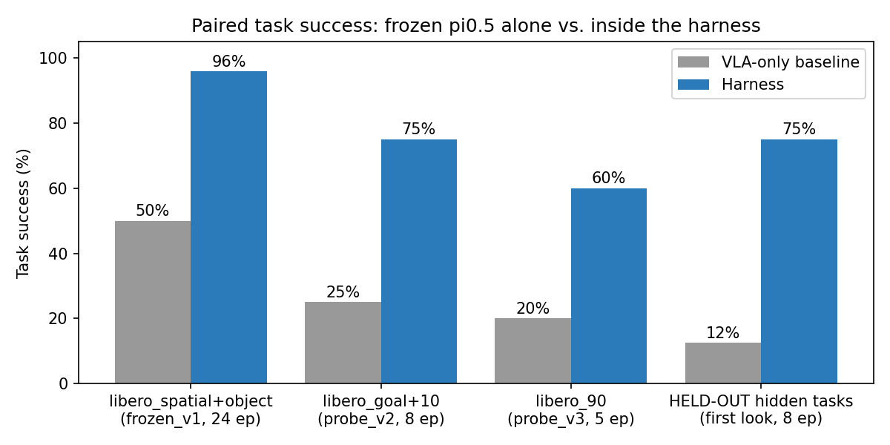
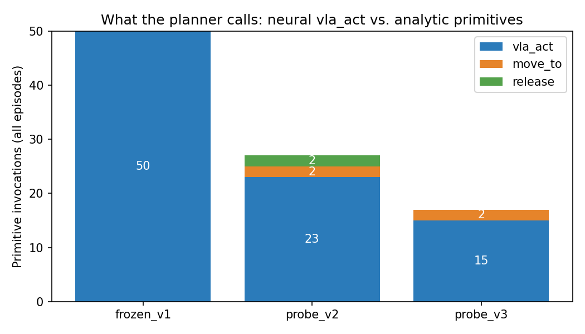
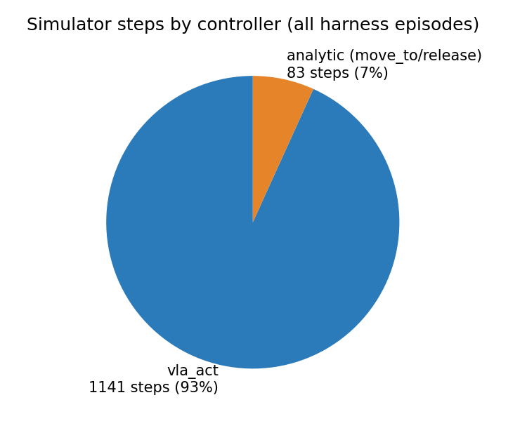
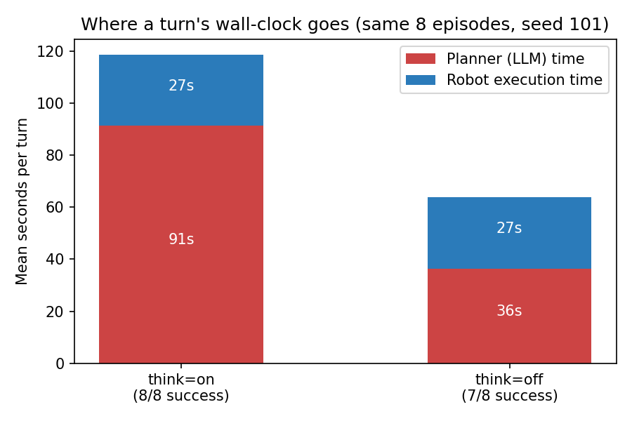
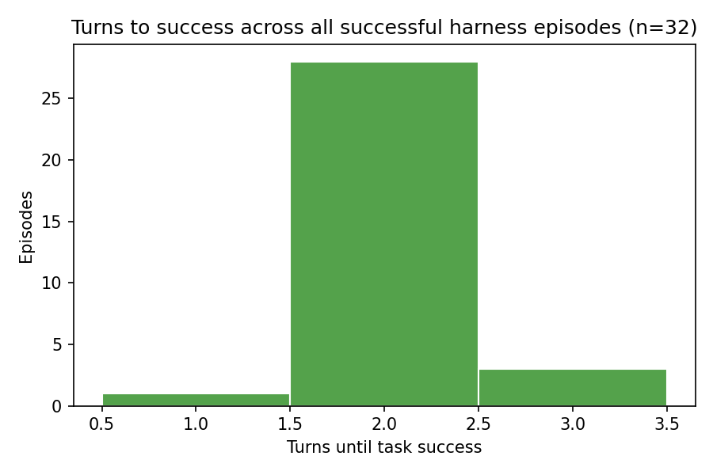

# Harness VLA on native LIBERO: trace-driven iteration takes a frozen pi0.5 from 50% to 95.8% paired task success

## What we did

We wrapped a **frozen** pi0.5 VLA policy (RLinf-Pi05-LIBERO fullshot SFT, never fine-tuned by us) inside the harness from arXiv:2607.08448v2: an LLM planner (gemma4:12b via Ollama, temperature 0) that invokes **one primitive per turn** — the neural `vla_act(prompt, max_chunks, tau)` or the analytic `move_to` / `release` — then observes the result and replans. Task success is always judged by the benchmark's official predicates, never by the planner.

Over four days we ran six trace-driven improvement iterations (prompt contracts, recoverable per-turn guard/parse feedback, fixture handling, multi-object sequencing, LLM retries, and a symbolic `turn_history` memory). Every change was validated on **frozen evaluation protocols** with comparisons paired by `(task_suite, task_id, initial_state_index, seed)`. Full iteration log: `docs/runs/HARNESS_LIBERO_ITERATIONS_20260812_20260816.md`.

## Experiments

| Experiment | Where | What it measures |
|---|---|---|
| **frozen_v1** | `libero_spatial` + `libero_object`, 4 tasks × 2 initial states × 3 seeds = 24 episodes (`benchmarks/eval_protocol_v1.json`) | Main regression suite; harness vs. VLA-only baseline on short-horizon tasks |
| **probe_v2** | `libero_goal` + `libero_10` (long-horizon), 4 tasks × 2 states × 1 seed = 8 episodes (`eval_protocol_v2.json`) | Difficulty ladder: fixture manipulation (drawer, stove) and multi-object placement |
| **probe_v3** | `libero_90`, 5 tasks × 1 state × 1 seed (`eval_protocol_v3.json`) | Generalization probe: stacking, appliance buttons, relational placement, compartment insertion |
| **think ablation** | frozen_v1 subset, seed 101 (8 episodes, identical tuples) | Cost/benefit of the planner's thinking mode (`--planner-think on/off`) |
| **held-out hidden tasks** | 4 tasks never run before (spatial 7, object 8 × 3 seeds; goal 7, libero_10 8 × 1 seed = 8 episodes) | Anti-overfitting check: first and only look, code frozen, zero adjustments |

All runs on a single V100 GPU (VLA server, port 8010); planner runs CPU-only.

## Results

The harness beats the VLA-only baseline on every suite, and the gap **widens with task difficulty**: +45.8 pp on frozen_v1 (95.8% vs 50.0%), +50 pp on long-horizon probe_v2 (75% vs 25%), +40 pp on libero_90 probe_v3 (60% vs 20%). The baseline's frozen_v1 score is inflated by libero_spatial (12/12); it scores 0/12 on libero_object, where the harness scores 11/12.

**Held-out check.** Because all six iterations were tuned while looking at the visible tasks, each protocol reserved hidden tasks that were never executed until the end. Run once with the code frozen: harness **6/8 (75%)** vs baseline **1/8 (12.5%)** — including 5/6 vs 0/6 on frozen_v1's hidden pair. The only new failure ("put both moka pots on the stove") is the already-known physical grasp failure mode, not a prompt that failed to generalize.

## How the harness behaves

**What the planner calls.** The VLA does the manipulation: `vla_act` accounts for 88 of 94 primitive invocations. Analytic primitives appear exactly where they are needed — `move_to release_pose` + `release` to set down non-final objects in multi-object tasks (probe_v2) and to recover in libero_90 (probe_v3). The harness is a thin decision layer, not a scripted controller.

**Who controls the robot.** Measured in simulator steps, the VLA controls the arm **93%** of the time (1,141 steps) vs 7% analytic (83 steps). The harness's value comes from *when* and *with which sub-goal* it invokes the VLA, not from replacing it.

**Where wall-clock goes.** With thinking on, the planner takes 91 s per turn vs 27 s of robot execution — the LLM dominates latency (CPU-only inference in our setup). Turning thinking off cuts planning to 36 s/turn (2.5× faster) at the cost of one success (7/8 vs 8/8 on identical episodes).

**Turns to success.** Successful episodes need **2.06 turns on average**: typically one `vla_act` that completes the task plus the closing turn, with multi-object tasks using 4–6. The replan loop is invoked sparingly — it matters most when something goes wrong.

## Conclusions

1. **A frozen VLA plus a replanning harness beats the same VLA alone on every suite tested**, with the largest gains on long-horizon and unseen-suite tasks — consistent with the paper's core claim that the harness contract adds robustness without touching policy weights.
2. **Symbolic feedback is what unlocked the gains.** All six iterations changed only what the planner sees (prompt contracts, per-turn error feedback, `turn_history`) — never the VLA, the predicates, or the protocols. Task success went from 29.2% (initial harness) to 95.8% under identical episodes.
3. **The remaining failures are physical, not logical.** Traces show correct multi-object sequencing (grasp → place → release → next object, no re-grasping); the frozen VLA simply misses the grasp on the second object. Further progress needs either grasp retries with varied prompts or analytic approach poses — not more planner logic.
4. **Thinking mode is a latency/accuracy dial**: 2.5× faster turns for −1 success. With a GPU-served planner the trade-off would likely vanish.
5. **The improvements generalize.** On held-out tasks seen for the first time after all tuning was done, the harness kept its margin (75% vs 12.5% baseline) and reproduced the visible-task pattern (baseline 0/6 on hidden frozen_v1, harness 5/6). No sign of prompt overfitting.
6. **Not claimed:** probes use 1 seed (no error bars) and iterations are cumulative (no per-iteration ablation). Next steps: more seeds on the probes, a `turn_history` ablation, and attacking the remaining physical-grasp failure mode.

*Scientific scope: the one-primitive-per-turn loop, `vla_act` contract, analytic primitives, and official-predicate authority follow arXiv:2607.08448v2 (paper-confirmed). Prompt contracts, empty-hand fixture tau, and `turn_history` are unspecified details we fixed (paper-compatible). Protocols, guards-as-feedback, retries, and all charts are local instrumentation (beta-only).*
